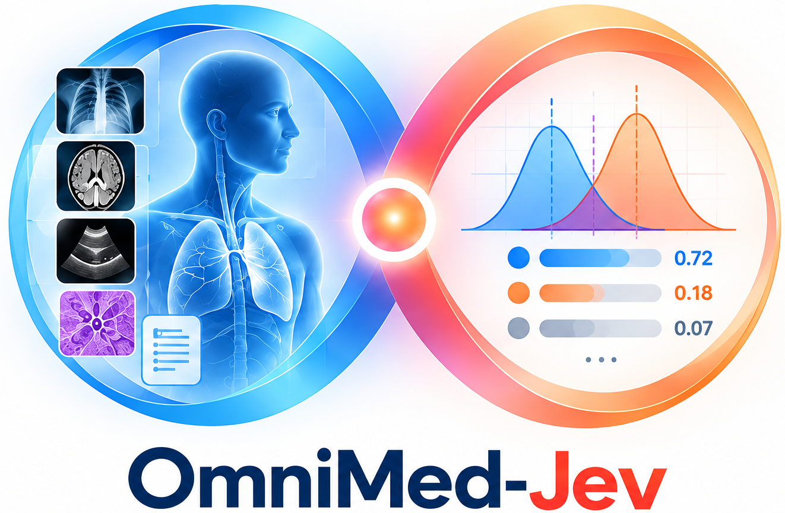
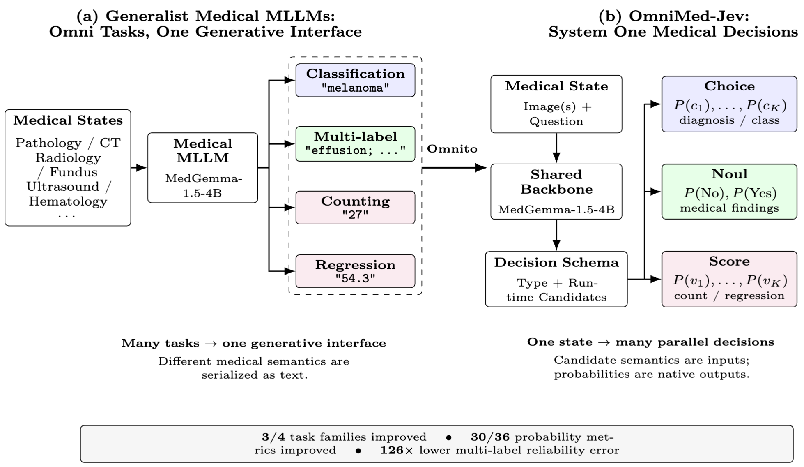
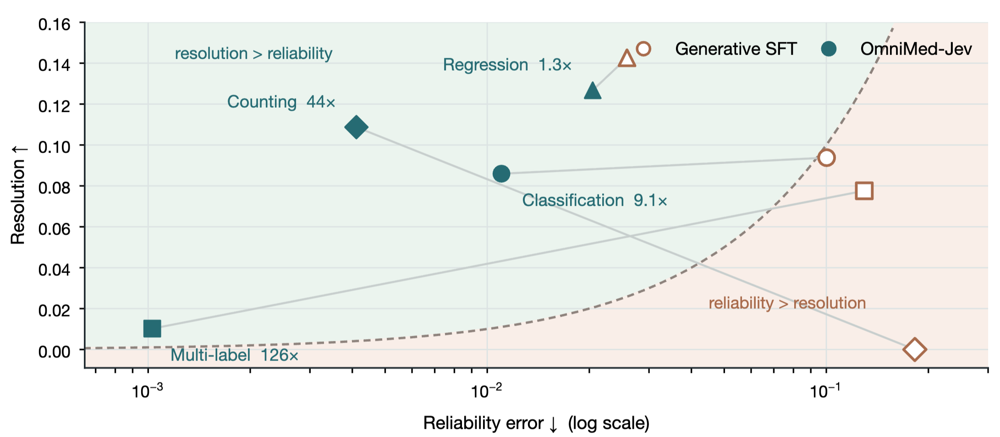
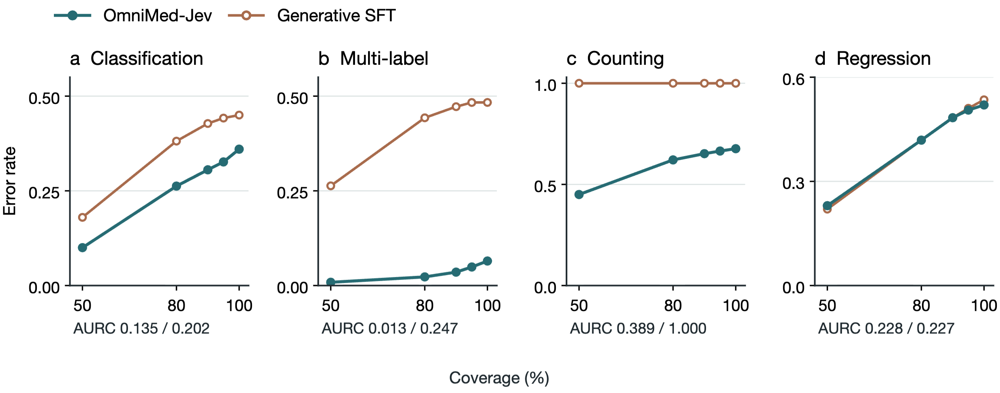
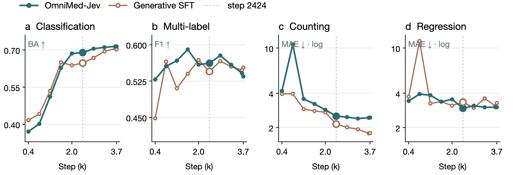

<div align="center">
  
  <h1>OmniMed-Jev</h1>
  <p><b>Calibrating LVLM Confidence for Trustworthy Medical Multimodal Decisions via System One</b></p>
  <p>
    <a href="https://arxiv.org/abs/2610.00381"></a>
    <a href="https://lytang63.github.io/OmniMed-Jev/"></a>
    <a href="https://huggingface.co/xmutly/OmniMed-Jev-4B"></a>
    <a href="LICENSE"></a>
    <a href="https://www.python.org/downloads/"></a>
    <a href="https://huggingface.co/google/medgemma-1.5-4b-it"></a>
  </p>
  <p>
    <a href="README.md">English</a> | <a href="README.zh-CN.md">简体中文</a>
  </p>
</div>

**Project page:** [lytang63.github.io/OmniMed-Jev](https://lytang63.github.io/OmniMed-Jev/)

A medical model that answers correctly and a medical model whose stated
confidence can be trusted are two different things. OmniMed-Jev is an attempt to
close the gap by changing **what the model outputs**: instead of serialising a
diagnosis, a finding list, a count or a measurement into text, it answers with a
**normalised distribution** over a candidate set supplied at inference time.

The model is a MedGemma-1.5-4B backbone with a shared decision scorer. One
forward pass over one medical state can carry every decision about that state —
fourteen findings on a chest radiograph, four cell counts on a blood smear —
and each one comes back as a probability that means what it says.

---

## ⭐ Highlights

| | What it is | Evidence |
|---|---|---|
| 🎯 | **Confidence by construction.** The decision distribution *is* the output object, so calibration is trained and measurable rather than repaired after the fact. | Reliability error falls by **9.1× / 44× / 126×** in three of four families — see [Decision quality](#-results) |
| ⚖️ | **No accuracy tax.** Point predictions stay comparable; the paper claims no predictive advantage, and needs none. | [Point prediction](#-results) — three of the four families differ by less than the paired interval resolves, and counting is the one that does not |
| 🌐 | **Omni coverage, one scorer.** 8 modality labels, 15 source datasets, 4 task families and 3 decision types, all through one candidate-conditioned probability model. | [Datasets](#-datasets) |
| 🔧 | **A decision space you can edit at inference time.** Permute it, restrict it, delete the answer — no retraining. | [Probes](#-results) — operations a fixed output head cannot express at all |

The one family where the generative baseline stays ahead is **counting**, and it
is documented with its mechanism rather than buried: folding a distribution over
an ordered grid to its expectation shrinks extreme values toward the centre.

---

## 🔬 Motivation: a token probability is not a decision probability

Two models make the same diagnosis on the same image and are wrong equally
often. One reports high confidence on the cases it gets wrong; the other lowers
its confidence when it is about to be wrong. Their accuracy is identical — yet
only the second is useful for deciding which cases deserve re-examination.

Generalist medical multimodal models have become genuinely generalist in what
they *perceive* and in what they *solve*. That diversity stops at the output.
A diagnosis, a set of findings, a cell count and a continuous measurement are
bounded decisions with different structures, and all of them are serialised into
text, so the computation behind the answer is the conditional token distribution
the model uses to write prose:

```
p_LM(y | S, Q) = Π_t p(y_t | y_<t, S, Q)
```

The probability of a *string* is not the probability of the *decision* that
string encodes. Recovering one from the other is an inference step bolted on
afterwards — constrained decoding, explicit candidate scoring, post-hoc
calibration — and all of them operate on a quantity the model was never trained
to produce. The medical literature has measured the consequence repeatedly:
reported confidence overestimates accuracy, calibration varies across
specialties, and deferral policies behave unpredictably because the confidence
they consume was never the probability of the decision.

<p align="center">
  
</p>

*Figure 1. (a) Generalist medical MLLMs span many modalities and tasks, but every
output is serialised through the same autoregressive text channel. (b) OmniMed-Jev
replaces the output channel, not the backbone. (c) Headline consequences.*

---

## 🧩 OmniMed-Jev: typed decisions over a runtime candidate set

A decision is a tuple `D = (Q, T, C)`: a question, a type, and a finite candidate
space `C = {c₁, …, c_K}`. **The candidate set is part of the model input**, not a
fixed output head, and the model returns a normalised vector over it:

```
p_θ(c | S, D_j),  c ∈ C_j,   Σ_{c ∈ C_j} p_θ(c | S, D_j) = 1
```

Three types cover the bounded decisions of structured clinical prediction:

| Type | Candidate space | What the decision rule gets | Used for |
|---|---|---|---|
| **Choice** | unordered finite set | `p(c)` for every class, not just the winner | diagnosis over pooled organ/tissue classes |
| **Noul** | `{No, Yes}`, one per finding | one probability per finding, so a rule can escalate them one by one | findings on a chest radiograph |
| **Score** | ordered grid `{v₁, …, v_K}` | a distribution over the grid → an expectation and an interval | cell counts, ejection fraction, retinal grade |

`Score` candidates are **never permuted**: position *is* the ordinal index, and
the candidate text is self-contained (`- 45 ⟩` already says 45), so moving a
candidate changes only the position it occupies and never how it reads.

A fourth type, `Span` (a box emitted as a span decision), is defined in the
interface contract but not scored here: the coordinate head collapsed to a
constant box rather than localising findings, so the paper makes no claim about
detection in either direction.

### Relation to Jev

OmniMed-Jev is a medical implementation and test of the decision-interface idea
motivated by [Jev](https://typesafe.ai/blog/introducing-system-one-models-and-jev),
not a medical copy of a general decision model. It keeps a medical multimodal
backbone and adds a shared candidate-scoring mechanism. The Jev properties it
carries:

| Jev element | Generative SFT | OmniMed-Jev |
|---|---|---|
| **Dynamic decision space** — candidates are input semantics, not indices of a fixed classifier | ✗ fixed vocabulary | ✅ candidate text enters the context; the head reads the option it is scoring |
| **Complete distribution** — a normalised distribution, not a string or an argmax | ✗ next-token likelihood | ✅ `softmax` over the candidate set |
| **Typed decisions** — Choice / Noul / Score as distinct primitives | ✗ everything is text | ✅ all three trained by one cross-entropy |
| **One state → many decisions** — in a single forward pass | one answer per prompt | ✅ 14 `Noul` decisions on one radiograph, 4 counts on one smear |
| Workflow composition — narrow decisions combined by deterministic code | ✗ | ✅ presence → count → localise |

Because the head reads hidden states at **marked positions**, no projection to
the 262k-token vocabulary is required:

```
z_jk = f_φ(h_state, h_{c_jk}),      p_jk = exp(z_jk) / Σ_l exp(z_jl)
```

All three types share **one** objective — the cross-entropy between the model
distribution and the target distribution induced by the annotation:

```
L(θ) = − (1/M) Σ_j Σ_k q_jk log p_jk
```

`Noul` reduces to this with `C = {False, True}`; a `Score` grid with an
interpolated target takes the same path, so a one-hot label and a soft label are
the same code.

---

## 📊 Results

Every number below comes from an **interface-controlled** comparison: the two
arms share the backbone, the training images, the preprocessing, the adapter
configuration and the step budget, and differ in their output objective. Both
are evaluated at step 2424; the test set is 726 held-out states, the same rows
for both.

### Point prediction — no advantage claimed for either representation

| Task family | Metric | Gen-SFT | OmniMed-Jev | Δ |
|---|---|---:|---:|---:|
| Classification | Balanced accuracy ↑ | 0.6469 | **0.6892** | +0.0422 |
| Multi-label | F1 ↑ | 0.5449 | **0.5618** | +0.0170 |
| | Precision ↑ | 0.5679 | **0.5950** | +0.0271 |
| | Recall ↑ | 0.5498 | **0.5602** | +0.0104 |
| Counting | MAE ↓ | **2.1429** | 2.5159 | +0.3730 |
| Regression | MAE ↓ | 3.3400 | **2.9488** | −0.3912 |

The classification, multi-label and regression gaps are **not distinguishable
from zero at 95%** (paired bootstrap: classification `[−0.0196, +0.1059]`,
multi-label `[−0.0264, +0.0620]`, regression `[−0.8756, +0.0173]`), the
multi-label ordering reverses under pooled micro averaging, and the tally is
checkpoint-dependent. The only difference distinguishable from zero is the
counting MAE — and it favours the generative arm.

### Decision quality — where the interface changes the model

Each cell is **Gen-SFT / OmniMed-Jev**; lower is better for ECE, reliability and
AURC, higher for resolution.

| Task family (n) | ECE ↓ | Reliability ↓ | Resolution ↑ | AURC ↓ |
|---|---:|---:|---:|---:|
| Classification (200) | 0.2589 / **0.0806** | 0.1002 / **0.0110** | **0.0938** / 0.0860 | 0.2020 / **0.1351** |
| Multi-label (2,795) | 0.2981 / **0.0114** | 0.1294 / **0.0010** | **0.0776** / 0.0102 | 0.2474 / **0.0126** |
| Counting (201 / 126) | 0.4204 / **0.0408** | 0.1824 / **0.0041** | 0.0000 / **0.1087** | 1.0000 / **0.3890** |
| Regression (200) | 0.1267 / **0.0913** | 0.0258 / **0.0205** | **0.1426** / 0.1268 | **0.2272** / 0.2280 |

> **How the baseline's probabilities are obtained.** A generative model emits an
> answer string, not a distribution, so its numbers here are a **reconstruction**:
> each candidate's continuation is scored by its summed log-probability under the
> language model and normalised across the candidate set. Nothing in its training
> ever made those likelihoods sum to one — this is a pseudo-distribution, whereas
> OmniMed-Jev's is the training objective itself. One cell is dominated by that
> difference: the counting AURC of 1.0000 and resolution of 0.0000 follow
> mechanically from the reconstruction, because on a 33-way integer grid its
> top-ranked candidate never equals the annotated count (0 of 126 rows), and a
> distribution whose top-1 is never correct cannot separate easy from hard cases.
> Read that cell as a statement about the reconstruction, not as an estimate of
> how much confidence information a generative model carries in general.

<p align="center">
  
</p>

*Figure 3. Reliability error (abscissa) against resolution (ordinate). All four
OmniMed-Jev families sit on the green side of the `resolution = reliability`
boundary; the generative baseline crosses to the other side in classification,
multi-label recognition and counting.*

**This separation is the point.** The generative baseline passes the
*discrimination* test more often than the *calibration* test: its reliability
error exceeds its resolution in three of four families. It orders cases usefully
while its reported numbers overstate how often it is right. OmniMed-Jev inverts
that — cutting reliability error by 9.1× (classification), 44× (counting) and
126× (multi-label) while resolution stays comparable in classification and
regression — so the same ordering is expressed in a quantity a downstream rule
can consume.

Every metric is defined and scoped in [`docs/METRICS.md`](docs/METRICS.md).

That is why the paper reports reliability and resolution **together** and never
ECE alone: a model that always emits the class prior has reliability error near
zero and resolution exactly zero, and ECE alone cannot tell the two failure
modes apart.

### Selective prediction

<p align="center">
  
</p>

*Figure 4. Top-label error when answering only the most confident 50/80/90/95/100%
of decisions. AURC pairs are OmniMed-Jev / Gen-SFT.*

Ranking by the decision arm's probabilities and keeping the most confident half
leaves a much lower error rate than ranking by the baseline's reconstructed
confidence at the same coverage, and the gap widens as coverage increases. On
multi-label recognition the area under the selective risk curve falls from
0.2474 to **0.0126** — a twenty-fold reduction in the error a deferral policy
carries at every coverage level.

### Learning dynamics

<p align="center">
  
</p>

*Figure 2. All ten matched checkpoints of both arms, on the shared 726-state test
set. The dashed line marks step 2424, the comparison checkpoint.*

The interfaces differ in trajectory as well as endpoint: the generative baseline
leads early in classification and is overtaken after step 1616, while in
regression it passes through a large mid-training excursion that OmniMed-Jev
does not exhibit. Counting is the one family the generative baseline leads
throughout.

### A decision space you can edit at inference time

Because candidate semantics are **inputs**, the decision space can be
manipulated at inference time without retraining. These operations have no
counterpart under a generative interface without adding a separate scoring
mechanism — a fixed classifier head cannot accept them at all, since its logits
are indexed by position.

| Probe | Tests | @1616 | @2424 |
|---|---|---:|---:|
| Permutation, total variation ↓ | dynamic decision space | 0.1284 | 0.1413 |
| Permutation, top-1 agreement ↑ | | 0.6589 | 0.6622 |
| └ diagnosis / counting / regression | | 0.91 / 0.37 / 0.70 | 0.90 / 0.42 / 0.67 |
| Restriction to 2 candidates ↑ *(chance 0.50)* | | 0.8735 | 0.8719 |
| Restriction to 4 candidates ↑ *(chance 0.25)* | | 0.6717 | 0.7322 |
| Gold removal, runner-up selected ↑ | complete distribution | 0.8885 | 0.8752 |

Restricting to a two-option shortlist leaves accuracy far above chance, and
removing the annotated candidate makes the model select a plausible runner-up
rather than collapse.

### The counting boundary

Counting is the family the generative baseline wins, and the reason is specific
to the `Score` design rather than to the approach. A count is a bounded
measurement whose annotation is a single integer; this interface represents it
as a distribution over an ordered grid and folds it to the expectation, while the
baseline emits the integer directly. The likely mechanism is the folding: an
expectation over a wide grid shrinks extreme values toward its middle, so a model
uncertain across the upper range reports a value closer to the centre. It is the
only family in the suite where the probability object costs accuracy, and the
mechanism is specific enough to be fixed rather than fundamental.

### Scope of the claim

The comparison cannot separate the interface from the denser supervision
(factoring the annotations yields **155,729** decision-level targets from the
same 23,558 images) and the additional decision head that come with it. What is
measured is therefore decision modelling **as implemented**, not the interface
alone. The probabilities are evaluated retrospectively on held-out data from the
same sources as training; per-class, per-source and out-of-distribution
behaviour is not measured. `docs/REPRODUCE.md` lists every respect in which the
two arms are not like-for-like.

---

## 🗂️ Datasets

Both arms train on the same **23,558 states** and are scored on the same **726
held-out states**. The suite spans **15 source datasets**, **8 modality labels**
and **4 task families**; the splits were constructed here rather than adopted
from a published benchmark, so neither arm can profit from having been tuned
against a widely used test set.

| Family | Type | Source datasets | Modalities | States | Decisions | Test | Download |
|---|---|---|---:|---:|---:|---:|---|
| **Classification** | Choice | TissueMNIST, PathMNIST, OCTMNIST, Organ{A,C,S}MNIST, BloodMNIST, DermaMNIST, PneumoniaMNIST, BreastMNIST | histology, pathology, CT, haematology, dermatology, ophthalmology | 10,000 | 10,000 | 200 | [MedMNIST+ 224](https://zenodo.org/records/10519652) |
| **Multi-label** | Noul ×14 / ×13 | ChestMNIST, [ChestX-Det](https://github.com/Deepwise-AILab/ChestX-Det-Dataset) | chest radiography | 10,000 | 139,537 | 200 | [MedMNIST+ 224](https://zenodo.org/records/10519652) |
| **Counting** | Score K=33 | [TXL-PBC](https://huggingface.co/datasets/KeenForgeAI/TXL-PBC-corrected) | haematology microscopy | 878 | 3,512 | 126 | `huggingface-cli download KeenForgeAI/TXL-PBC-corrected --repo-type dataset` |
| **Regression** | Score K=101 / K=5 | [CAMUS](https://huggingface.co/datasets/MedOtter/CAMUS), RetinaMNIST | ultrasound, fundus | 2,680 | 2,680 | 200 | [`KeenForgeAI`-style HF download](https://huggingface.co/datasets/MedOtter/CAMUS) |
| **Total** | 3 types | **15 datasets** | **8 labels** | **23,558** | **155,729** | **726** | |

Classification pools the ten MedMNIST collections into a single choice problem
over their organ and tissue classes. Regression mixes two grids — the ejection
fraction on 101 points, the retinal grade on 5 — through the same `Score`
mechanism, which is what makes them comparable at all.

### How the splits were built

```
source datasets ──► converted tree ──► preprocessed rows ──► balanced subset ──► states
   (15 sets)        datas/converted/    529,673 train       29,842 train        23,558 states
                    omnimed-suite/      121,638 test          (task-balanced)    155,729 decisions
```

- **Train** — a task-balanced subset: up to 10,000 rows per task family, with
  empty answers capped at 25%, then restricted to the four decision families.
  That is 29,842 − 3,614 − 2,670 = **23,558** rows, one per image.
- **Validation** — **600** states, a seeded 40-per-source draw. This is the dev
  set the comparison checkpoint was selected on.
- **Test** — **726** states, held out, identical for both arms.

The partition itself ships in this repository — uid manifests plus the test and
validation states — so the numbers can be reproduced without retraining
anything. See **[`data/README.md`](data/README.md)**.

---

## 🚀 Quickstart

```bash
git clone https://github.com/lytang63/OmniMed-Jev && cd OmniMed-Jev
conda create -n omnimedjev python=3.12 -y && conda activate omnimedjev
export CONDA_ENV=omnimedjev          # so scripts/env.sh activates it for you
pip install -e .
```

### 1. Weights and data

The downloaders need `aria2c` and `huggingface-cli`, which `pip install -e .` does not provide.

```bash
./scripts/download_models.sh                    # MedGemma-1.5-4B -> models/
./scripts/download_datasets.sh                  # -> datas/raw/  (7 groups)
python scripts/convert_datasets.py medmnist chestx camus txlpbc
./scripts/run_preprocess.sh start               # async; poll with `status`

# task-balanced draw, then keep the four decision families (-> 29,842 / 23,558)
python scripts/make_train_subset.py \
    --source datas/preprocessed/Preprocessed-omnimed-suite/train.jsonl \
    --out datas/balanced/train.jsonl --per-task 10000 --empty-cap 0.25
python scripts/make_train_subset.py \
    --source datas/preprocessed/Preprocessed-omnimed-suite/validation.jsonl \
    --out datas/sft/Preprocessed-omnimed-suite/validation.jsonl --per-task 0
python scripts/make_eval_subset.py --out datas/eval

# the decision states both arms are scored on
python scripts/build_medjev_data.py \
    --src datas/sft/Preprocessed-omnimed-suite/train.jsonl --out datas/medjev/train.jsonl
python scripts/build_medjev_data.py \
    --src datas/preprocessed/Preprocessed-omnimed-suite/validation.jsonl \
    --out datas/medjev/validation.jsonl --per-source 40
python scripts/build_medjev_data.py \
    --src datas/eval/Preprocessed-omnimed-suite/testing.jsonl --out datas/medjev/testing.jsonl
```

The archive extraction, the uid filter that turns 29,842 rows into 23,558 and
every path in the chain are in [`docs/REPRODUCE.md`](docs/REPRODUCE.md). If you
would rather not rebuild anything, the partition itself ships in
[`data/splits/`](data/README.md).

### 2. Train

```bash
CUDA_VISIBLE_DEVICES=0 ./scripts/run_train_medjev.sh   # OmniMed-Jev (two stages)
CUDA_VISIBLE_DEVICES=0 ./scripts/run_train_sft.sh      # the generative baseline
```

A single A800-80GB per arm, ~13 h each. See
[`docs/REPRODUCE.md`](docs/REPRODUCE.md) for the full item-by-item
configuration and the one line on which the two arms differ.

### 3. Evaluate

```bash
CUDA_VISIBLE_DEVICES=0 ./scripts/run_full_eval.sh
```

Scores every checkpoint of both arms, runs the decision-space probes, and
recovers the generative arm's distribution from its own logits. Every stage
skips work that already has output.

### 4. Or just use the released model

The released checkpoint is a ~150 MB adapter plus decision head on top of
`google/medgemma-1.5-4b-it`. Point inference at a state file and it writes
folded predictions plus the full decision distributions:

```bash
python scripts/infer_medjev.py \
    --checkpoint output/medjev-lora \
    --data data/splits/testing_states.jsonl \
    --out-dir datas/eval/checkpoint-final
```

Because the candidate set is part of the input, you can edit it at call time —
`scripts/probe_medjev.py` is a worked example of permuting, restricting and
removing candidates, and those operations need no retraining.

---

## 📦 Released splits

| File | Rows | What it is |
|---|---:|---|
| [`data/splits/training_uids.txt`](data/splits/training_uids.txt) | 23,558 | the training uids |
| [`data/splits/validation_uids.txt`](data/splits/validation_uids.txt) | 600 | the dev uids |
| [`data/splits/testing_uids.txt`](data/splits/testing_uids.txt) | 726 | the test uids |
| [`data/splits/testing_states.jsonl`](data/splits/testing_states.jsonl) | 726 | test **decision states**, with targets |
| [`data/splits/validation_states.jsonl`](data/splits/validation_states.jsonl) | 600 | validation decision states |
| [`data/splits/testing_sft.jsonl`](data/splits/testing_sft.jsonl) | 726 | the same test rows in the generative arm's format |
| [`data/splits/chestx-det_validation_manifest.json`](data/splits/chestx-det_validation_manifest.json) | 289 | the ChestX-Det hold-out rule and file list |

Image paths inside the states are **relative to the repository root**, so once
the converted tree is materialised at `datas/converted/omnimed-suite/` they load
unchanged. Join the two arms on `uid`:

```
<source-split>:<source>:<question-file>:<case>:<task_type>:<case>
```

Weights and images are **not** in this repository; the manifests plus the
public source datasets are enough to rebuild them exactly.

---

## 📁 Repository layout

```
OmniMed-Jev/
├── omnimedjev/                  the package
│   ├── engine/
│   │   ├── medjev.py            ⭐ the interface contract: markers, decision space,
│   │   │                          the shared scorer, the unified loss, folding
│   │   ├── medjev_model.py      backbone wrapper + batch assembly
│   │   ├── medjev_metrics.py    calibration / selective-prediction metrics
│   │   ├── preprocess.py        converted question JSONs -> SFT rows
│   │   ├── train.py             generative-arm trainer
│   │   ├── infer.py             generative-arm inference
│   │   ├── evaluate.py          string-based task evaluation
│   │   └── check_dataset.py     dataset sanity checks
│   ├── interfaces.py            stage entry points + environment checks
│   ├── __entry__.py             the `omnimedjev` CLI
│   └── vars.py                  experiment configuration
├── scripts/
│   ├── convert_datasets.py      source datasets -> the converted tree
│   ├── download_datasets.sh     fetch the source datasets
│   ├── download_models.sh       fetch MedGemma from ModelScope
│   ├── build_medjev_data.py     compile rows -> decision states
│   ├── train_medjev.py          two-stage training (head, then head + LoRA)
│   ├── infer_medjev.py          inference + workflow + folding
│   ├── probe_medjev.py          permute / restrict / drop-gold / add-none
│   ├── eval_medjev_metrics.py   probability metrics -> metrics.json / .md
│   ├── eval_sft_logit_conf.py   the generative arm's distribution, from logits
│   ├── sweep_medjev.py          every checkpoint: infer -> fold -> score -> metrics
│   ├── sweep_sft.py             the same, for the generative arm
│   ├── compare_medjev.py        side-by-side tables
│   ├── run_train_medjev.sh      ⭐ launches the released run
│   ├── run_train_sft.sh         ⭐ launches the baseline
│   ├── run_full_eval.sh         ⭐ score everything, run the probes
│   └── env.sh                   cache/proxy/conda setup for the launchers
├── configs/                     the released run's configuration
│   ├── train-sft.yaml           the generative baseline
│   ├── preprocess.yaml          six-family preprocess, if run by hand
│   ├── evaluate.yaml            the task evaluator
│   ├── evaluate-medjev.yaml     scoring the decision arm by hand
│   └── infer-*-conf*.yaml       the failed self-report attempts (Appendix F)
├── data/                        the released partition (+ figure numbers)
├── docs/
│   ├── REPRODUCE.md             end-to-end reproduction, hardware, protocol
│   └── METRICS.md               every metric, defined and scoped
└── assets/                      logo, paper figures
```

> The code and scripts call the model **MedJev** — the working name used during
> development. It is the same model the paper calls OmniMed-Jev.

### Weights

Both released checkpoints are on Hugging Face: **[`xmutly/OmniMed-Jev-4B`](https://huggingface.co/xmutly/OmniMed-Jev-4B)**
— the decision arm at the repository root, the generative baseline under
`generative-baseline/`.

| Artifact | Weights | Notes |
|---|---:|---|
| `medjev-lora` | ~150 MB | LoRA adapter + decision head; 13.95 h on one A800 |
| `sft-lora` | ~75 MB | LoRA adapter only; 12.86 h on one A800 |

The full checkpoint directories are larger than the weights alone (~230 MB and
~180 MB respectively) because training checkpoints also carry optimiser state,
which is not needed for inference.

---

## ⚖️ Limitations and ethics

- **Bounded decisions only.** The interface covers decisions with enumerable
  candidate sets. Free-form report generation and coordinate regression are not
  scored here, and the detection implementation did not produce usable
  localisation output, so no claim is made about that family in either
  direction.
- **Factorised supervision.** The two arms see the same images, but factoring the
  annotations by decision semantics gives the decision arm 155,729 targets
  against 23,558. Denser supervision plausibly explains part of the late
  classification crossover; that is a hypothesis, and the ablation that would
  test it has not been run.
- **Evaluation scope.** Four families, 726 held-out states and three decision
  types are enough to test whether the interface effect is general, and not
  enough to establish clinical utility.
- **Not clinically validated.** These are retrospective predictors. No component
  of this work is intended or validated for diagnostic use, the decision
  probabilities have not been assessed prospectively in a clinical workflow, and
  a model that *ranks* decisions well is not thereby safe to deploy. Deferral
  relocates error rather than removing it.
- **Data.** This work uses only de-identified, publicly available medical imaging
  datasets and collects no new patient data. The splits inherit the licence of
  each source dataset.

---

## 📝 Citation

```bibtex
@article{tang2026omnimedjev,
  title   = {OmniMed-Jev: Calibrating LVLM Confidence for Trustworthy Medical
             Multimodal Decisions via System One},
  author  = {Tang, Luyao and Chen, Cheng},
  journal = {arXiv preprint arXiv:2610.00381},
  year    = {2026},
  url     = {https://arxiv.org/abs/2610.00381}
}
```

See also [`CITATION.cff`](CITATION.cff).

## 🙏 Acknowledgements

Built on [MedGemma-1.5-4B](https://huggingface.co/google/medgemma-1.5-4b-it), and
developed against [NanoJev](https://github.com/TianyuCodings/NanoJev), an open
nano replica of [Jev](https://typesafe.ai/blog/introducing-system-one-models-and-jev).
The suite is assembled from public datasets — MedMNIST+, ChestX-Det, TXL-PBC and
CAMUS — and we thank their authors for releasing them.

## 📄 License

Apache-2.0 — see [LICENSE](LICENSE).
